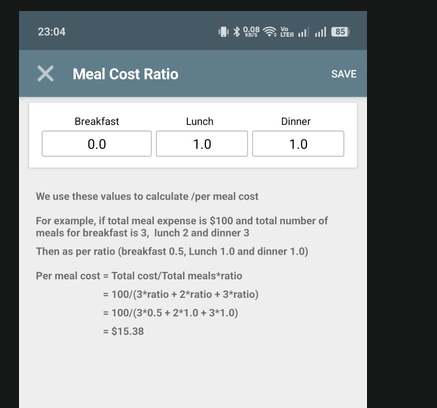

# Requirements
I need a web app to track meal expenses in a shared household. The app should have the following features.

- user need to be authenticated and has full access to the app after that
- user can create new month or any specific period to track expenses. no need to bound this with any date or something. any topic also can be added. just a name and everything will be inside it will be that specific. it could be expense of july or expense of trip to paris.
- user can add expenses with the following details:
  - amount 
  - description
  - quantity (optional, default to 1, must have an option to select kg or liter or any other unit)
  - date (optional, default to current date)
  - category (e.g., groceries, dining out, utilities, etc.)
  - who paid (user can select from a list of household members)
  - meal_expense (boolean, to indicate if the expense is related to meals)
  - if not meal expense, the user can select multiple participants from the list of household members who shared the expense
- a expense list will be shown with details
- there will be another section to add meals for every day. it'll be a list of date containing number of meals per day. clicking it would show the details of meals for that day, including who had how many meals. The user can add or edit meals for each day. also a member can add meals in advance for future days. 
- there will be a claculation of meals according to this: 
- also need a settings page where i can add members and manage these calculations.
- by default the last item of the expense list will be opened so that i do not need to open it every time i land on the application.
- need a page where we can see how much meal a person have, who ows how much to whom and total meal summary for the month. this page should also have a print option to print the summary.

these are the overall features. now let's talk about the tech part.

- the applicaton should look modern and mobile responsive. 
- it'll be web applicaiton. and we;ll host it on github pages. no need to use backend or any database. we need to save things in josn and need a way to backup and restore data easily. so the data will be stored in json files and we can download and upload them for backup and restore.
- the application should be built using React.js for the frontend. there will be no backend at all. All data will be stored in the hosted frontend application. The application should be a single-page application. 